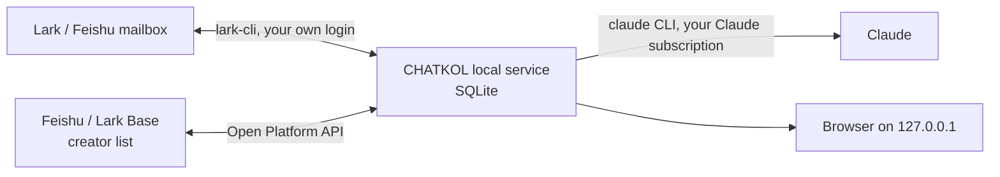

# CHATKOL

**A local-first dashboard for running creator (KOL) partnerships over email.** CHATKOL connects your work mailbox, your creator list and Claude, and turns hundreds of ongoing creator conversations into a daily to-do list you can clear in one sitting.

[中文说明 →](README.zh-CN.md)

> The interface and the setup guide are in Simplified Chinese. CHATKOL is built for teams that work in Chinese and reach creators worldwide: reply templates ship in English, Traditional Chinese, Korean and Japanese.

## Why

Sending the first email to a creator is the easy part. The hard part is everything after: who replied, what they quoted, whose turn it is, which follow-up is due, whose address bounced. That information ends up scattered across a mailbox, a spreadsheet and an outreach tool. CHATKOL syncs your mailbox and creator list every five minutes and shows it all on one page, where you also read, price, reply and follow up.

## What it does

- **Today's work, in six lists**: active conversations (yours to answer first), replies waiting for you, quotes waiting for your price, follow-ups due, bounces, and creators to message by DM.
- **AI reads every reply**: Claude summarises each reply in Chinese, tags it (quote, budget question, interested, details, decline), pulls out every quoted price (including from attached media kits and rate cards) and gives a full translation.
- **Replies from your templates, with an offer bar**: open a creator and the reply is already assembled. Pick what this email does (counter-offer, accept, ask for their rate, decline, thank you), pick a layout (prose, bullets, short), set the price, number of videos, platform and currency, and toggle add-ons. Changing the price swaps only the price sentence and keeps your edits. The AI only writes the opening line and answers questions your template doesn't cover. Describe a change in one sentence of Chinese and it edits just that.
- **Follow-ups**: a first nudge on day 3 and a second one 7 days later (configurable). Send them in one click, or switch on automatic follow-ups. Each email is re-checked right before it goes out, and creators who replied, bounced or were dropped are skipped.
- **Pricing context**: followers, median views of recent videos and the creator's quote converted to USD; where video data is available, view range, trends and past sponsored posts; with a target CPM set, a reference price too. The price is always your call.
- **Creator profiles**: a one-line AI portrait of each creator and a judgement of whether their audience is the one you want; lists sort by best fit.
- **Synced with your Feishu / Lark Base table**: progress, next step, latest activity, first-email date and quotes are written back; your own columns (status, target price, notes) are read in.
- **Alerts**: if mail sync, the AI or sending keeps failing, you get a Feishu message, and another when it recovers.

## How it works

- **Runs on your Mac.** A background service (launchd) syncs every five minutes and keeps its data in a local SQLite database. The web page is served on 127.0.0.1 only.
- **No API keys.** Mail goes through [lark-cli](https://www.npmjs.com/package/@larksuite/cli) with your own login; the AI goes through the [Claude Code](https://www.npmjs.com/package/@anthropic-ai/claude-code) CLI with your own Claude subscription.
- **Standard library only.** Python 3.9 or later, which macOS already ships, and no third-party packages.

## Principles

- **You decide what gets sent.** Apart from automatic follow-ups you switch on yourself, every email needs your click and a confirmation.
- **No secrets in the project.** App credentials, the Claude token and the mailbox login stay in your user directory and in lark-cli.
- **Local only.** The service listens on 127.0.0.1; every API call needs the page's access token, and Host and Origin are checked.
- **The AI doesn't invent facts.** Product details and terms come only from your config; anything it doesn't know is flagged for you to fill in.
- **Attachments are untrusted.** Files creators send are stored in a cache folder, read, and never executed.

## Getting started

You need:

- A Mac with Node.js (to install `lark-cli` and `claude`)
- A Lark or Feishu work mailbox, and a custom app with mail permissions (needs your admin's approval)
- A Feishu or Lark Base table for your creator list
- A Claude subscription

The easiest way to install is to let an agent do it:

1. Download or clone this repository.
2. Open the folder in Claude Code and say: “按 SETUP.md 帮我装好 CHATKOL” (“set up CHATKOL by following SETUP.md”).
3. The agent asks about your product, your terms and the languages you work in, then walks you through creating the app, logging in, filling in `config.json`, preparing the table columns, rewriting the templates for your product, a self-check, and installing the background service. It tells you when a step needs you: waiting for admin approval, typing the app secret in Terminal, authorising in the browser.

Then open http://127.0.0.1:8765.

[SETUP.md](SETUP.md) has every step if you prefer to do it by hand.

## Configuration

- `config.json` holds the sender, mailbox, creator table, product description and terms, pricing reference, follow-up gaps and reply add-ons. Start from [`config.example.json`](config.example.json); every section explains itself.
- `templates/` holds the reply template and the follow-up and DM templates. They ship with a fictional example product (Acme Fit, a home-workout app). Edits take effect immediately.

## Repository layout

| Path | What it is |
|---|---|
| `app/` | The service and the web page |
| `templates/` | Reply, follow-up and DM templates (example product) |
| `scripts/` | Setup helpers: credentials, table columns, self-check, background service |
| `SETUP.md`, `AGENTS.md` | Step-by-step setup and rules for the agent that installs or maintains it |
| `config.example.json` | Configuration template |

## License

[MIT](LICENSE)
