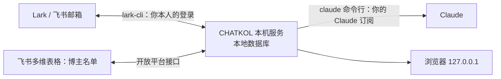

# CHATKOL

**在你自己电脑上运行的 KOL 合作看板：接上邮箱、博主名单和 AI，每天的博主沟通变成一张清完就行的待办清单。**

[English →](README.md)

## 为什么做

和博主谈合作，难的往往不在发第一封信，而在之后几百段同时进行的对话：谁回了、报了多少、轮到谁回、哪天该跟进、谁的邮箱退信了。这些信息散在邮箱、表格和外联工具里，每天要来回翻。

CHATKOL 每 5 分钟同步一次邮箱和博主表，把这些事整理成一屏待办。读信、定价、回信、跟进都在同一个页面里完成。

## 功能

**今天要处理**：六张卡片，点开就是对应的清单。

| 清单 | 里面是谁 |
|---|---|
| 有希望！ | 还在来回谈的博主，轮到你回的排最前 |
| 待你回复 | 对方来信、你还没回的，按「报了价 / 有问题要答 / 拒绝了」分组 |
| 报价待你定价 | 对方报了价、你还没给价的 |
| 该跟进 | 到期或快到期的跟进 |
| 退信 | 退回来的信，可以改地址重发 |
| 私信待发 | 没有公开邮箱的博主，附对应语言的私信模板 |

**AI 读信**：每封回信由 Claude 读成中文，包括一句话摘要、类别（报价、问预算、有兴趣、问细节、拒绝等）、报了哪些价格（含附件里的 media kit 和报价单），并附整封翻译。

**回信：模板加出价**。打开一个博主，回信已经按你的模板拼好：

- 选这封做什么：出价（对方报过价就是还价，没报过就是直接出价）、接受报价、请他先报价、婉拒、回个谢。
- 选样子：段落、要点、简短三种，随时切换对比。
- 填价格、条数、平台、币种（默认用对方报价的币种），勾选附加条件，例如投流加推、赠送会员、折扣码分成、排他、广告标注。改价格只会换掉价格那一句，你手改过的地方都保留。
- AI 只写开头一两句和对方问到的具体问题。要改什么，用中文写一句「大意」，AI 只改相关的句子；也可以整封按大意重写。
- 支持英文、繁體中文、한국어、日本語。模板改一处，所有回信跟着变。

**跟进**：首封后第 3 天跟进一，再隔 7 天跟进二，天数可配置。可以打开「自动跟进」让到期的自己发出，也可以一键全部发。每封发出前都会再查一次，回了信、退信、标了不合作的自动跳过；发送途中随时可以暂停。

**定价参考**：打开博主能看到国家、粉丝、最近 10 条播放的中位数和对方报价折算成的美元；有视频明细时，还有播放区间、近期趋势和商单记录。配置了目标 CPM，还会给一个参考价。价格由你自己定，看板不替你下结论。

**博主画像**：AI 给每个博主写一句画像，判断他的观众是不是你要找的人群；清单默认按「画像最合适的在前」排序。

**和飞书表同步**：博主名单放在飞书（或 Lark）多维表格里。看板把「进度」「下一步」「最后动态」「首封日期」「对方报价」写回表格，你在表里填的「合作状态」「心理价位」「备注」看板也会读到。

**出问题会提醒**：邮箱同步、AI 或发信连续出错时，会通过飞书给你发消息，恢复后再提醒一次。

## 工作方式

- 全部在本机运行：后台服务每 5 分钟同步一次，数据存在本机的 SQLite 数据库里，网页只在 127.0.0.1 上打开。
- 不需要 API key：邮箱用你自己的 Lark 或飞书登录（lark-cli），AI 用你自己的 Claude 订阅（claude 命令行）。
- 程序只用 Python 标准库，macOS 自带的 Python 3.9 就能运行；用 launchd 装成开机自启、出错自动重启的常驻服务。

## 安全原则

- **发什么由人决定**：除了你主动打开的自动跟进，每封邮件都要你在页面上点「发送」，再在确认框里确认。
- **密钥不进项目**：应用凭证、Claude 令牌、邮箱登录只保存在本机用户目录和 lark-cli 里。
- **只在本机访问**：服务只监听 127.0.0.1，每个接口都要带上页面里的访问令牌（每次启动服务重新生成），并校验 Host 和 Origin，别的网站发不了请求。
- **AI 不编内容**：产品介绍和合作条件只用配置里写好的说法；遇到不知道的事，AI 会标出来让你补，不会自己编数字。
- **附件按不可信文件处理**：博主发来的附件放在本机缓存目录，只读取，不执行。

## 开始使用

需要准备：

- 一台 Mac，装好 Node.js（用来安装 `lark-cli` 和 `claude` 两个命令行工具）
- Lark 或飞书的工作邮箱，以及一个开通了邮箱权限的企业自建应用（需要管理员审批）
- 一张飞书或 Lark 多维表格，用作博主名单
- Claude 订阅

推荐让 agent 帮你安装：

1. 下载或克隆这个仓库。
2. 用 Claude Code 打开这个文件夹，对它说：「按 SETUP.md 帮我装好 CHATKOL」。
3. agent 会先问清你的产品、合作条件和要联系的语言，然后带你建应用、授权登录、填配置、补齐表格的列、按你的产品改写模板、跑一遍自检，最后装成常驻服务。需要你本人操作的几步（等管理员审批、在终端输入 App Secret、扫码授权）它会提前告诉你。

装好后用浏览器打开 http://127.0.0.1:8765 。想自己一步步装，看 [SETUP.md](SETUP.md)。

## 配置

- `config.json`：发件人、邮箱、博主表、产品介绍和合作条件、定价参考、跟进间隔、回复框里的附加条件开关。从 [`config.example.json`](config.example.json) 开始，每一节都附有说明。
- `templates/`：回信模板、跟进和私信模板。仓库里带的是一个虚构的示例产品（Acme Fit，居家健身 App），改完马上生效。

## 目录

| 路径 | 内容 |
|---|---|
| `app/` | 本机服务和网页 |
| `templates/` | 回信、跟进、私信模板（示例产品） |
| `scripts/` | 安装辅助脚本：填应用凭证、补齐表格列、自检、装常驻服务 |
| `SETUP.md`、`AGENTS.md` | 安装步骤，和给安装、维护它的 agent 的规则 |
| `config.example.json` | 配置模板 |

## 许可证

[MIT](LICENSE)
